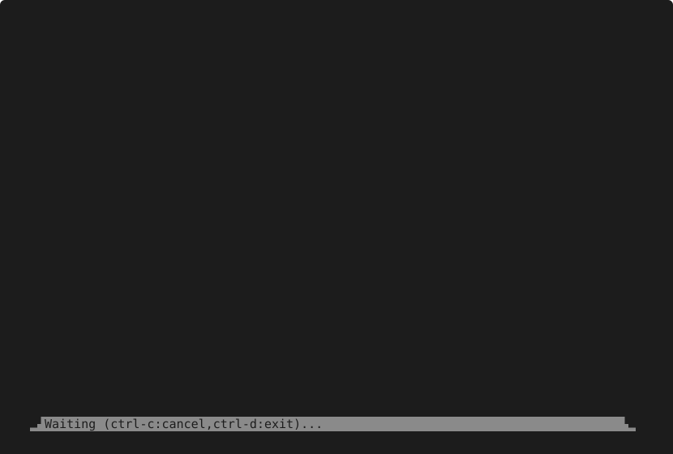

# m8 (mEight) - The Composable Agentic Shell Harness

A full agentic harness in under a megabyte, needing only what a shell already
has like bash, sed, and curl.

```
>>> m8 :crew/devyn -- 'One word -> do you like Haiku?'
▐ 🤖:
│ Yes.

▐ 🧠:crew/devyn/+/swlyayqtjk

>>> m8 :crew/devyn -- 'Can you make me one?'
▐ 🤖:
│ Moonlight on still ponds
│ Crickets stitch the dark with song
│ Dawn waits behind hills

▐ 🧠:crew/devyn/+/psbarddrym
```

It's flexible enough to run any chat-shaped model including the
1979 text adventure Z-machine engine! Here's a transcript where
the Zork-I game acts as the agent:

*[Zork Agent Defintion](docs/examples/coop/zork.md)/[Full Ledger](docs/examples/coop/zork+.md)(slowed down for readability - click to open where you can hold down to pause)*
[](https://raw.githubusercontent.com/fuglaro/m8/main/docs/examples/coop/zork.svg)

In the transcript demo above, the player wasn't actually a human!
It was really GPT-6-Luna playing a Zork subagent (through a tool).
Here is the transcript where the Luna agent is being guided by the user:

*[Agent Definition](docs/examples/coop/zork-player.md)/[Full Ledger](docs/examples/coop/zork-player+.md)*
[](https://raw.githubusercontent.com/fuglaro/m8/main/docs/examples/coop/zork-player.svg)

If you inspect those [Agent Definition](docs/examples/coop/zork-player.md) and [Full Ledger](docs/examples/coop/zork-player+.md) links, you can see that the agent definition, the transcript, and the tool protocols are all one language - **"m8"** - rendered everywhere as markdown. It's all just well structured markdown, and there's little more to the TUI than that.

‼️ Pre-release: open for comment, and still settling / [Style Guide here](dev/STYLE_GUIDE.md) ‼️

## What it is

m8 brings agents to the shell, rather than a shell to an agent.

* **One format does four jobs.**
  * An agent definition, a transcript, the wire format and the tool protocol
    are all one grammar.
  * So any of them can be written, piped, diffed or edited by hand.
* **The ledger is the truth.**
  * Records keep the order they happened in, and nothing is dropped.
  * Every api is a projection of it. Reordering, combining and forgetting are
    things a projection does, never something done to the ledger.
* **Turns are files, and chats reference them.**
  * A chat folder holds immutable turns naming their parent with a movable
    pointer into them, similar to Git's objects and refs but for conversations.
* **Tools are filters.**
  * A tool reads m8 and writes m8, and talks to the person through the ledger.
  * So it stays in the pipeline even while it is interactive.

It is fiercely opinionated about form so that it can hold no opinion at all
about model, prompt, tool or agent structure. Those are the operator's, in files
that are easy to write, generate and share.

## The mission

* The conversation is the artifact.
  * Files you own, in one grammar.
* The ledger is the truth.
  * Anything letting it say what did not happen is a bug, not a gap.
* Opinionated on form, and nothing else.
  * Capability by composition, never a plugin api.
* Sugar at the surface, and only there.
* Small enough for a distribution to carry for thirty years.

[Why m8](docs/why.md) is the argument, and the field it joins.

## Getting started

Zig is the only thing a build needs, and nothing is fetched.

```bash
zig build -Dsmall=true
export PATH=$PWD/zig-out/bin:$PATH
```

A first agent, with no network or key, on the toy provider:

```bash
c=${XDG_CONFIG_HOME:-~/.config}/m8-st8
mkdir -p $c/core/providers $c/mobs/demo
cp .m8-st8/core/providers/toy.json $c/core/providers/
echo '* :brain::/toy/eliza' >$c/mobs/demo/eliza.md

m8 :demo/eliza -- "I am not sleeping well."
```

* `eliza` is Weizenbaum's doctor of 1966, played from the ledger.
* For a real model, [Providers](docs/providers.md) sets up oMLX, Anthropic and a
  ChatGPT plan.
* `m8 --help` lists every command, and `m8 COMMAND --help` explains one.

## A short tour

An address names an agent's chat, and saying something to it moves the chat on:

```bash
m8 :demo/mathy -- "Tell me about the Riemann Sphere."
m8 :demo/mathy -- "Tell me more."
m8 :demo/mathy//aside -- "And the Möbius strip?"     # a subchat, forked
```

Each turn it keeps is a markdown file:

```bash
cat .m8-st8/mobs/demo/.chats/mathy/+/tduyxbutjb.md
```
```
* :brain::demo/mathy

* :raising_hand::
  > Tell me about the Riemann Sphere.

* :robot::
  > The Riemann Sphere is a ...
```

The same thing is a pipeline, and each step can be had on its own:

```bash
m8 ref :demo/mathy hi | m8 send | m8 tag :demo/mathy     # what m8 :demo/mathy -- hi does
m8 ref :demo/mathy | m8 encode openai-responses            # the request a model would see
m8 query :demo/critic//job "Review that."                  # the reply alone, as text
```

An address alone at a terminal opens `riff`, an editor pinned under the
conversation:

```
>>> m8 :crew/devyn
▐ 🙋:
│ can you write a haiku to scratch/haiku.md about having good mates?

▐ 📲:edit,call_354d69588f1c4cd090828705078c4dca
│ * path `"scratch/haiku.md"`
│ * new_string
│   ```text
│   Good mates share the road
│   Laughter warms the evening air
│   Home is where we meet
│
│   ```
▐ 📜:call_354d69588f1c4cd090828705078c4dca
│ ```diff
│ +Good mates share the road
│ +Laughter warms the evening air
│ +Home is where we meet
│ ```
▐ 🟢:call_354d69588f1c4cd090828705078c4dca

▐ 🤖:
│ Written to `scratch/haiku.md`.

▐ 🧠:crew/devyn/+/fqwurujpru

   ▂▟📲edit(path=scratch/haiku.md,new_string=Good mates sha …✥35_937▙▂
   ██Waiting (enter:dispatch,alt-enter/ctrl-j:newline)...           ██
   ▏Thanks! That's awes...
```

An agent is a file in the same grammar. This one cannot widen what it may do,
whatever it includes or is told:

```m8
▐ 🧠:demo/shields

▐ 🛡️:jail

▐ 🧠:demo/helpers

▐ 🧠:/local/Ternary-Bonsai-8B-mlx-2bit,max_output_tokens:8192
```

> * :brain::demo/shields
>
> * :shield::jail
>
> * :brain::demo/helpers
>
> * :brain::/local/Ternary-Bonsai-8B-mlx-2bit,max_output_tokens:8192

* `demo/shields` defines `jail`, and the bare 🛡 turns it on for every tool.
* `demo/helpers` brings whatever tools it defines, and all of them run jailed.
* The model named last is the one that answers.

`m8 :games/zork` plays a 1979 Infocom story file through the same ledger as any
model. The chat is the save file, and forking it forks the world.

## Where things are

* [Why m8](docs/why.md) — what it is for, and what others have already proved.
* [Commands](docs/commands.md) — addresses, composing, riff, casting, encoding, calling.
* [The language](docs/language.md) — records, sigils, tops and types, enough to
  write a parser from.
* [Tools](docs/tools.md) — how a call reaches a program, and how a tool asks the
  person.
* [Shields](docs/shields.md) — what a tool runs inside, and why it cannot widen.
* [Configs](docs/configs.md) — layers, mobs, chats, models and the environment.
* [Providers](docs/providers.md) — what a provider is, uploads, stats, and
  setting up real models.
* [Building](docs/building.md) — split commands, wire formats and the url
  transport, chosen at build time.
* [src/zmachine/README.md](src/zmachine/README.md) — the seam between a
  virtual machine and a provider.
* [dev/STYLE_GUIDE.md](dev/STYLE_GUIDE.md) — how the code and docs are written.

## License

MIT.
